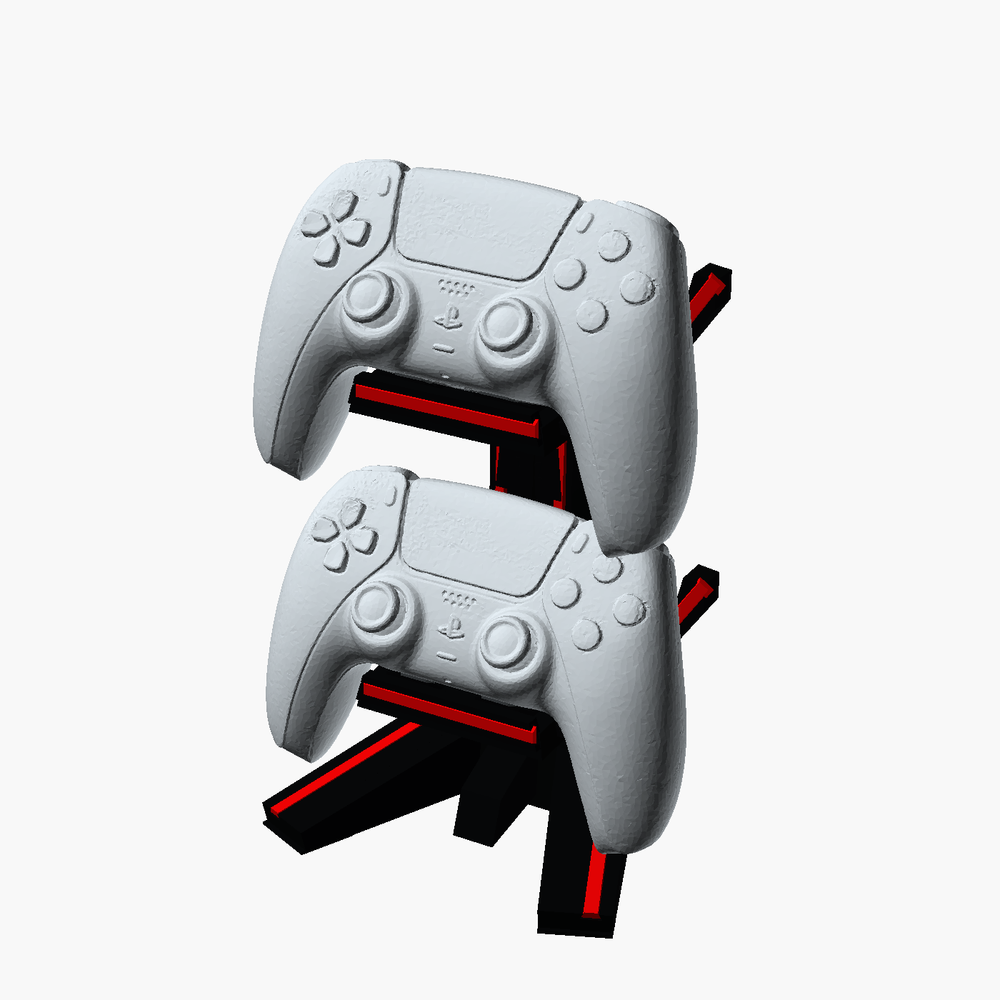

# F1-Inspired Dual PS5 Controller Stand

Clean-sheet parametric OpenSCAD model based on the supplied front, top, angled,
loaded, cradle-detail, base-detail, and fitted-accent views. The showcase's side
view was deliberately ignored as requested. A mechanically plausible side
profile was deduced from the other views. The central seating surfaces have now
been revised against a full-size DualSense scan. Only the controller's central
underside rests inside the bucket; its grips overhang. The horns are decorative,
not supports. Three shaped TPU pads per controller are required for the intended
seating arrangement.



CAD clearance checks pass for the reference scan. Physical no-rocking fit,
friction and print tolerances still require the prototype test below.

## Model architecture

- Overall target envelope: approximately 140 × 130 × 210 mm.
- Two cradles at floor datums 52 and 162 mm, on a 110 mm vertical pitch.
- Controllers sit at 30 degrees rearward recline on a scan-contoured central
  saddle with three separated, replaceable TPU pads. A central relief avoids
  the connector/recess area. Both grip handles remain outside the bucket.
- Lower cheeks clear the grips; the decorative horns sit behind the controller.
  The legacy inner guides are disabled. The lower controller is removed by a
  small lift followed by a forward pull, not a straight lift through the upper one.
- Six-section lofted backbone with a flat raised faceplate and optional generic
  `R1` racing mark. This intentionally avoids reproducing a commercial logo.
- Two swept faceted legs with flat front soles at Z = 0, coplanar with the
  central ground contacts. The V footprint and short central keel are retained.
- Ten separately printable red accent inserts: two base, two backbone, and six
  cradle pieces.
- Six TPU contact pads, three per cradle. The body remains approximately
  140 x 130 x 210 mm; loaded controllers extend above that body envelope.

## Insert mechanism

Every red accent is a single sliding dovetail piece. The body channel contains:

1. an undercut that prevents the insert lifting out;
2. a closed inner stop;
3. an accessible outer insertion/removal end; and
4. a local relief pocket near that end.

The matching insert has an integral printed wedge detent. During insertion the
long strip flexes slightly, the bump rides over the channel wall, and then seats
in the relief. This resists reverse sliding without glue, screws, magnets, or a
separate locking-key component. Use a thin plastic pick at the accessible end
to release the detent while sliding the insert out.

Default clearance is 0.22 mm per mating side and detent interference is 0.10
mm. Both are parameters near the top of the SCAD source. Print the coupon first.

## OpenSCAD modes

Set `render_mode` near the beginning of [f1_dual_controller_stand.scad](f1_dual_controller_stand.scad).
Keep the [generated](generated) folder beside the source: it contains the
scan-derived saddle, pad surfaces, configuration and display-only controller mesh.
The ready-to-print STLs do not need Python or the reference scan.

| Mode | Output |
| --- | --- |
| `assembled` | Black body, fitted red parts and TPU pads |
| `body` | Black main structure only |
| `pads` | Six TPU pads, flat bottoms on the bed |
| `cradle_test` | One isolated cradle for a physical fit test |
| `loaded` | Display-only assembly with two controller references; do not print |
| `hard_assembly` | Body plus fitted accents for collision checks; do not print |
| `inserts` | All ten red parts in one print layout |
| `inserts_base` | Two base inserts |
| `inserts_spine` | Two backbone inserts |
| `inserts_cradles` | Four arm inserts and two lip inserts |
| `exploded` | Installation relationship |
| `cradle_detail` | Isolated detailed bucket inspection |
| `coupon_body` | Black tolerance coupon |
| `coupon_insert` | Matching red coupon strip |

Example exports:

```bash
openscad -o f1_dual_controller_stand_body.stl \
  -D 'render_mode="body"' f1_dual_controller_stand.scad

openscad -o f1_dual_controller_stand_red_inserts.stl \
  -D 'render_mode="inserts"' f1_dual_controller_stand.scad
```

In the GUI, use F5 for preview and F6 for a full CGAL render. The assembled
preview explicitly renders the structural body to avoid imported-mesh display
artifacts, so its first preview takes longer than a simple CSG preview.

## Print guidance

### Main body

- Print upright on the two V legs.
- PETG or PLA+; 0.4 mm nozzle; 0.20 mm layers.
- 4–5 walls, 5 top/bottom layers, 20–25% gyroid or cubic infill.
- Use a 6–10 mm brim.
- The horizontal buckets require build-plate-only organic/tree supports beneath
  their floors. Use support blockers on dovetail channels, seating pockets, and
  controller-contact surfaces.
- Place the seam on the back of the backbone.

### Red inserts

- The supplied layouts place the broad buried dovetail face on the bed.
- Use 0.12–0.20 mm layers, 3–4 walls, and elephant-foot compensation.
- Avoid brim inside the detent area; a small external brim is acceptable.

### TPU contact pads

- Print [f1_dual_controller_stand_tpu_pads.stl](f1_dual_controller_stand_tpu_pads.stl)
  in flexible TPU, approximately 85A-95A. Do not substitute rigid PLA/PETG pads
  and expect the same tolerance accommodation.
- Start with 0.12-0.16 mm layers, 2 walls, 3 top/bottom layers and 15-25% infill;
  adjust speed and temperature to the filament and extruder. No supports.
- Each of the two layout rows contains front-left, front-right, then the wider
  rear pad from left to right. Preserve the printed orientation. Flat faces go
  into the pockets; shaped faces touch the controller shell.
- Seat each pad fully against its pocket floor. The default pocket is 0.10 mm
  smaller per side for TPU friction retention. `seat_pad_clearance` controls this;
  increase it towards zero in 0.05 mm steps if seating distorts the top surface.
- The pads are not cosmetic. They provide three separated compliant contact
  areas instead of balancing the controller on a small rigid central contact.

## Decorative Insert Coupon

Print `insert_fit_coupon_body.stl` and `insert_fit_coupon_insert.stl` with the
same material and settings planned for the full model. The insert should slide
with firm finger pressure, click into its relief, show no vertical rattle, and
remain removable with a plastic pick.

- Binding along the whole strip: increase `insert_clearance` by 0.05 mm.
- Excess rattle: reduce `insert_clearance` by 0.05 mm.
- Detent too aggressive: reduce `detent_interference` toward 0.05 mm.
- Detent too loose: increase it in 0.02 mm steps.

## Controller Fit Test

Print [controller_cradle_fit_test.stl](controller_cradle_fit_test.stl) and one
set of three TPU pads before the full body. Use the same rigid material and
settings as the body; support the underside where the slicer requires it.
The existing small dovetail coupon does not test controller fit.

Secure the isolated cradle on a block or fixture at least 40 mm above the desk
so the overhanging grips can extend below its floor. Do not mistake grips
touching the desk, or the unsecured prototype tipping, for cradle rocking.

1. Insert the pads fully and place a bare standard DualSense at the seating angle.
2. Verify contact on all three pads, using thin paper strips to find an unloaded
  pad. Neither horn should touch the shell or controls.
3. Gently alternate pressure on the left/right grips and front/rear of the shell.
  Reject alternating hard contacts, visible pivoting, pad lift or sliding.
4. Check full stick and trigger travel, button clearance and the actual controller's
  connector region. Do not force a controller or compress a control into the seat.
5. On the full stand, test one controller in each tier and both together, desk
  flatness, ordinary placement/removal, and modest cable pull without tipping.

The checked removal path keeps the controller at its seating angle: lift about
5 mm, pull forward approximately 70 mm, then lift away. Insertion reverses that
path. It clears the other seated controller; a straight vertical extraction of
the lower one is not promised.

No grip cover, DualSense Edge, measured mass distribution, friction coefficient,
pad-compression model or physical print has been validated. Contact-pad fit and
material compliance require calibration on the actual print. Keep
`show_inner_guides = false`; changing the seat angle, pitch or generated surfaces
invalidates the recorded checks and requires regeneration and validation.

## Validation performed

The revised prints were exported with OpenSCAD 2021.01 and checked with trimesh.
All seven export files are watertight with consistent winding and every component
starts at Z = 0. Counts: body 1, cradle test 1, TPU pads 6, combined red inserts 10,
and category insert plates 2/2/6. The body has 13,930 triangles.

Python-FCL checks against all 1,980,421 triangles of the original scan found:

- approximately 0.61 mm minimum clearance to the rigid body and fitted accents;
- approximately 15.24 mm between the two seated controllers;
- more than 9.1 mm between the scan and the exposed rear horn surfaces;
- clear removal paths with the other controller present, using conservative
  distance-based stepping with a 0.4 mm rigid-clearance bound;
- less than 0.15 mm sampled vertical mismatch between the pad surfaces and scan;
- both front soles at Z = 0, with ground contacts spanning the full 140 mm width.

These are geometric checks, not a certification of physical no-rocking behaviour,
print strength, friction, long-term creep or tip resistance. Full stick deflection
is not present in the static reference scan.

See [analysis/FIT_ASSESSMENT.md](analysis/FIT_ASSESSMENT.md),
[analysis/revision_validation.json](analysis/revision_validation.json), and
[analysis/export_manifest.json](analysis/export_manifest.json). The original
body is preserved in [analysis/baseline_body.stl](analysis/baseline_body.stl).

## Regenerating and Checking

The [reference scan](references/dualsense-scan/Controller_HQ2.3mf) is from
[Benjamin Gonzalez on GrabCAD](https://grabcad.com/library/playstation-dualsense-controller-3d-scan-1).
It is a community scan, not certified Sony tooling geometry. The author notes
reduced accuracy behind the joysticks. The simplified display mesh is not used
for final collision tests.

Analysis dependencies are recorded in [analysis/requirements.txt](analysis/requirements.txt).
From this project directory, the configured local environment can reproduce the
generated geometry, exports and checks:

```powershell
& ..\.venv-cad-audit\Scripts\python.exe -m analysis.build_seat
& ..\.venv-cad-audit\Scripts\python.exe -m analysis.export_revision
& ..\.venv-cad-audit\Scripts\python.exe -m analysis.validate_revision
```

The export script defaults to the portable OpenSCAD under the workspace's
`.tools` directory; `--openscad` accepts another executable path. The historical
pose-sweep files describe the pre-fix model and are not the current validation.
